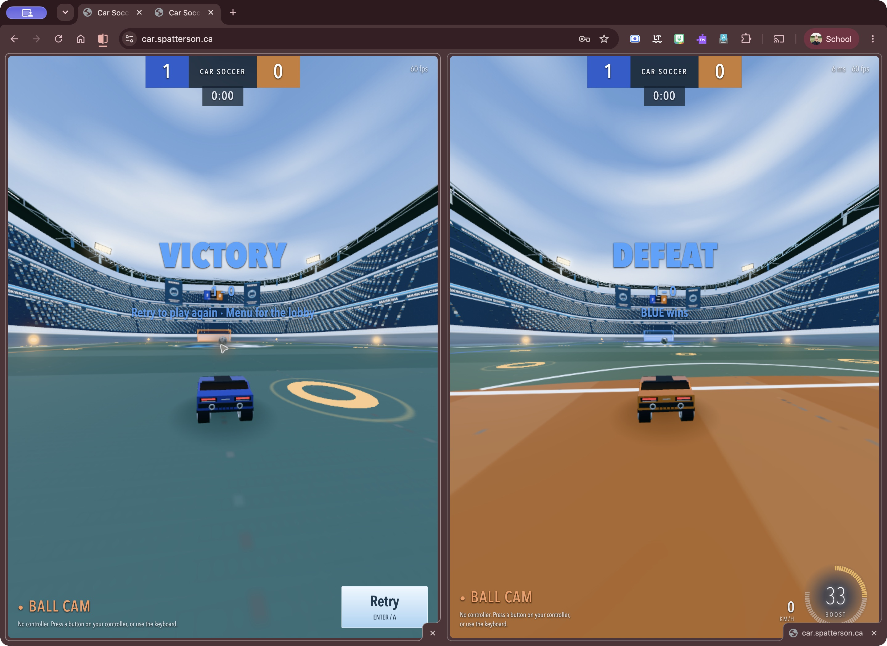
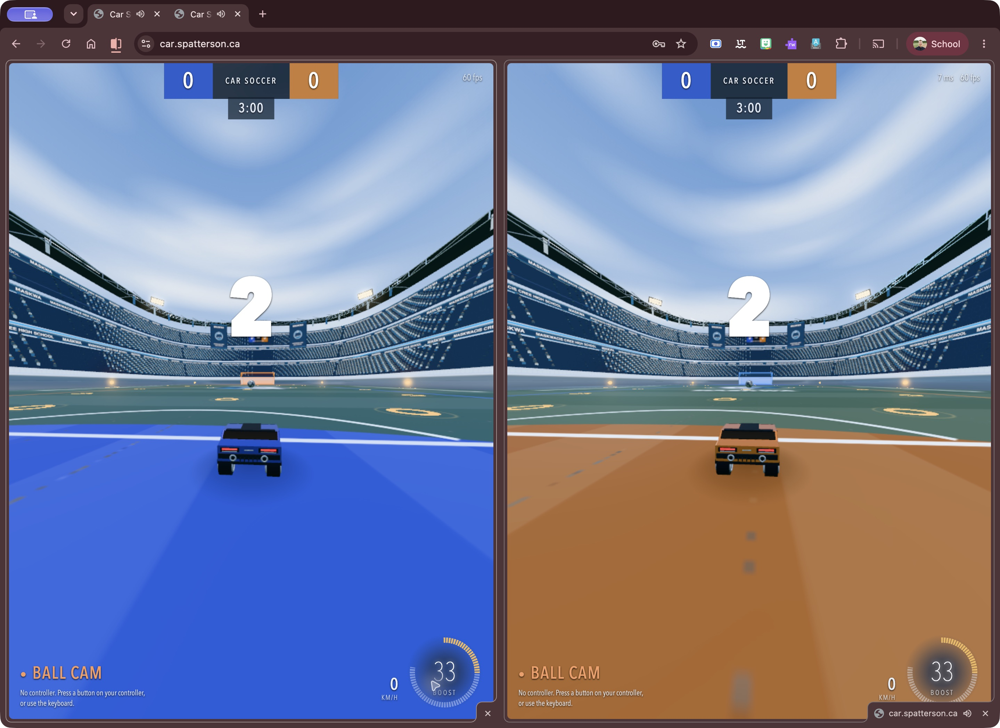
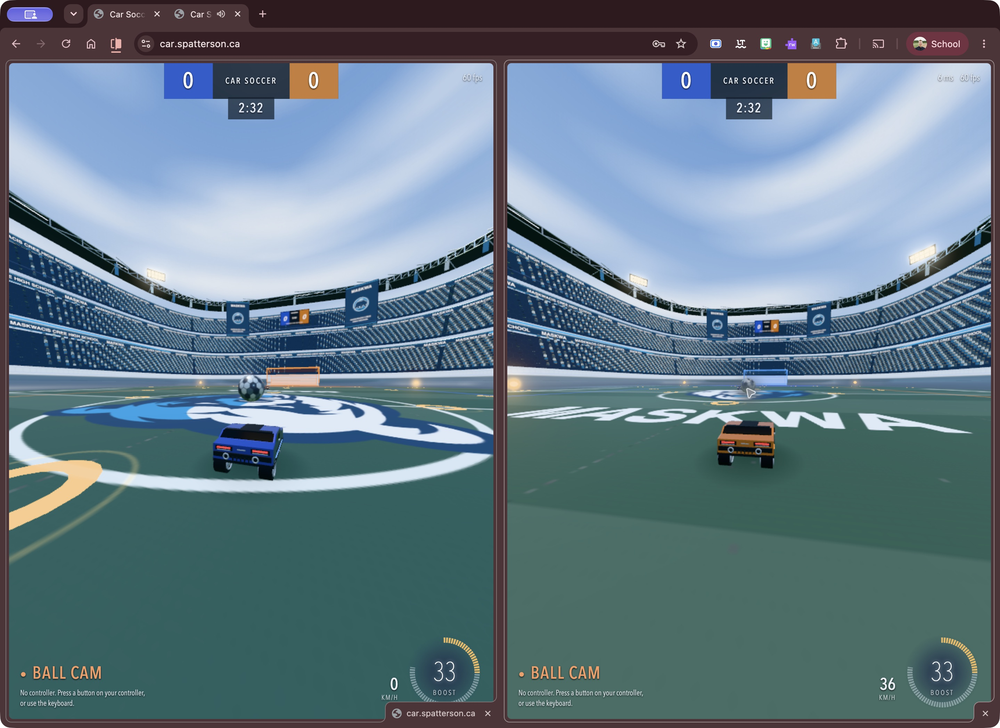

# Live multiplayer acceptance — 2026-10-25

**Passed** on [car.spatterson.ca](https://car.spatterson.ca/) with two authenticated Chrome clients in split view on one Mac, using normal keyboard and mouse controls.

Tested release: `20261024-controller-notices-c825a5e2fe92`

Application source: `c825a5e2fe928f6101dc8a949db8ea6c7a64d3bb`

Results combine direct observations during the session with the finished-match and Retry screenshots below.

| Check | Observed result |
| --- | --- |
| Initial kickoff | Session observation: both players responded to controls and moved from their kickoff positions. |
| Finished match | A real 1–0 match reached 0:00. The host saw Victory and Retry; the guest saw Defeat without Retry. |
| Host Retry | One click reset both clients to 0–0, restored the 3:00 clock, and started a new kickoff countdown. |
| Movement after Retry | Both cars moved again with separate throttle inputs. |
| Connection retained | Both clocks stayed synchronized; neither player rejoined the room. |

The match was completed through normal gameplay. No game-state injection, source change, binding change, server restart, or authentication change was used. An independent review of the saved screenshots supported the reported results.

This verifies two live clients on one Mac. It does not establish distinct-device LAN performance or physical-controller support. The dedicated test window was closed after the evidence was captured.

## Finished match: host-only Retry

## After the host clicks Retry

## Movement after Retry

The host and guest were driven separately. The guest is moving at 36 km/h in this capture, and both cars have left their reset positions.

These are unchanged screenshots of the game test. Build and regression CI is configured in GitHub Actions; production is hosted separately on SPN100 and does not use GitHub Pages.
