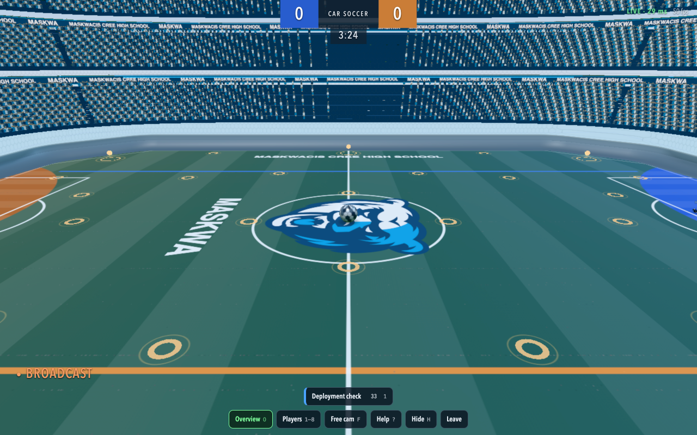

# Spectator production release — November 4, 2026

`https://carspectator.spatterson.ca` is live. The existing game password admits viewers
to a separate watch-only app. Host **Multiplayer → Host LAN room** on `car.spatterson.ca`
and share its five-character code. Viewers select Overview, Players or Free cam.
This feature watches browser-hosted LAN rooms; server rooms have a separate eight-character code.

## Frozen release and live state

| Item | Verified value |
| --- | --- |
| Release | `20261104-spectator-8c9a197033bc` |
| Runtime source | `8c9a197033bc5581738347beea2dbb60911431fc` |
| Image | `sha256:41b3fe3554c10515b739d76f00357fb088485a2ec153cdfc690480e4dbfddcf4` |
| Live container | `680851090bb23e690211d883e1fce26440f31e55a884835c41f11d4c22b7551b` |
| Health | Healthy, zero restarts at `2026-11-04T15:28:41Z` |
| Manifest SHA-256 | `776e5242820602a606ff4a148a42c2c2cc31f656ed6ac492dab57ffb82762997` |
| Packet SHA-256 | `bd20f704a1120b1eaf7cda5effd54294c329e1a5c8fc219bea63d0384209c9e6` |
| External operator SHA-256 | `e6fd6160cfa91728648762fef4d16c353886f838f957264d85639be439312cef` |
| Host receipt | `/home/sam/services/car-soccer/receipts/accepted-20261104-spectator-8c9a197033bc.json` |

The local packet and protected staging evidence are in
`.deployment/spectator-20261104/` under the integration worktree. Remote immutable packet files
are in `/home/sam/services/car-soccer/releases/20261104-spectator-8c9a197033bc`;
the independently pinned helper and archive are in its matching `release-tools/` directory.
Two earlier staging namespaces were retained; neither was activated. The first direct host
prepare attempt stopped before any action because `operator.py` shadowed Python's standard
library. The final helper is `release_operator.py`, uses Python isolated mode, and passed
direct CLI startup testing and the actual isolated Linux candidate checks.

Only Car Soccer was recreated. Its existing password-file mount, owner/mode/ACL, UID 101,
read-only filesystem, dropped capabilities, resource limits and dedicated edge network were
preserved. The config delta changes `CAR_RELEASE` and adds the single spectator origin line.
The game password and production password-hash bytes were never printed or committed.
The supplied password was consumed privately for login, aggregate room checks and logout.

Cloudflare Tunnel configuration advanced from version 52 to 53. It gained exactly:

```text
carspectator.spatterson.ca -> http://car-soccer:8080
CNAME carspectator.spatterson.ca -> b44f0cd5-6227-4d1a-9abb-30cccbf2540b.cfargotunnel.com
proxied=true; TTL=Auto; DNS record cc262fa5000be2f6a925f6bc26cac106
```

Removing the new route from the observed configuration yields the original configuration's
SHA-256 `fcdb265ecc4bab7325a37933c1098eacb05de76614b1f76b0aa0be80fdeca393`.
The connector retained its exact container identity, zero restarts and all 26 network attachments.
No router, firewall, WAF, Access, TLS or other hostname setting was changed.

## Verification

- The integrated five fixes retained their existing build, simulation, transport, admission,
  startup and 39-check local Chromium/WebRTC evidence in
  [the edge-case report](../2026-11-04-spectator-edge-fixes.md).
- Twelve release-helper tests passed, including partial config-write failures, stopped/missing
  container recovery, refusing unknown config/image/neighbor drift and direct command startup.
  The earlier independent Astra review found two rollback gaps; both were corrected and tested.
- The actual SPN100 candidate built from the accepted local base without external networking
  or remote dependency installation. Its exact file inventory, image configuration/layer prefix,
  synthetic authentication, protected assets, room boundaries and WebSocket rejection passed.
- Before activation, authenticated metrics showed zero rooms and zero connections. The probe
  signed out. The guarded Car-only activation passed health, gate, asset, config and preservation checks.
- Both public HTTPS origins accepted the existing game password. Ten JS/CSS/image files on each
  origin matched the packaged SHA-256 values. Anonymous protected-bundle requests returned 401.
- The live public UI created a browser-hosted LAN room; one spectator joined by code, while
  player count remained one. Kickoff, live snapshots, Overview, player follow, free-camera movement,
  Hide/Show, end-to-waiting, fresh-tick rematch and terminal host departure passed.
  Host departure was invoked through the existing session debug hook for deterministic cleanup.
- The selected WebRTC pair was `host -> host`; an application ping sample was 32 ms. This was
  one browser machine using both public origins. It does not measure two-device LAN latency.
  The fast channel submitted initial traffic and later used the supported reliable fallback.
- On the spectator origin, create/join/invite/leave/metrics returned 404 and a WebSocket attempt
  was rejected even after login. Both QA grants were revoked, temporary graphics preferences
  restored, test tabs closed and final room metrics were again zero/zero.

Luna mapped the acceptance controls. Sol reviewed recovery considerations after the separate
WebGPU change described below. The final browser and server observations are preserved in
[browser.json](browser.json) and [release.json](release.json).



[Open full image](overview.png)

## Shared-server preservation and recovery

All 50 neighboring containers matched their preflight snapshots at Car activation. At 15:23:56Z,
during browser checks, `webgpu-webgpu-1` was replaced with a different image/container. This
rollout's only Compose action targeted `car-soccer`; it issued no WebGPU command. The final
snapshot confirmed the other 49 neighbors and the full connector snapshot unchanged. The new
WebGPU container was healthy with zero restarts and its security/network/mount settings unchanged.
Its exact before/after identifiers are in `release.json`. No WebGPU data or configuration was touched.

Retained baseline image:
`car-soccer-private:20261024-controller-notices-c825a5e2fe92`, image
`sha256:2eba7107d939c2d9ff515992265b42f7bb44d16d15924e219d8971820f412ffb`.
Original `.env`, Compose and durable `record.json` are under:

```text
/home/sam/services/car-soccer/rollback/20261104T151516Z-20261104-spectator-8c9a197033bc/
```

The original recovery record and strict guard remain intact. **The rollback command currently
refuses the changed WebGPU neighbor before writing anything.** Coordinate with that service's
writer and revalidate its provenance before a future audited reconciliation of the expected
neighbor snapshot. Preserve the original record bytes, hashes, baseline image and config backups.
Do not bypass the guard or restore WebGPU as part of Car recovery. No rollback was executed.

After that recovery precondition is resolved, the pinned Car-only command is:

```sh
ssh sam@spn100 python3 -I /home/sam/services/car-soccer/release-tools/20261104-spectator-8c9a197033bc/release_operator.py rollback 20261104-spectator-8c9a197033bc 776e5242820602a606ff4a148a42c2c2cc31f656ed6ac492dab57ffb82762997 --expected-operator-sha256 e6fd6160cfa91728648762fef4d16c353886f838f957264d85639be439312cef --allow-session-reset
```

An application rollback also requires removing only the newly added spectator route/CNAME
through Cloudflare's UI, preserving all other routes. Existing game sessions and in-memory
rooms cannot survive recreation. Provider rollback and actual host rollback were not exercised.

## Remaining acceptance limits

Two physical devices on the target LAN, Wi-Fi client isolation, Safari/iOS/Android, controllers,
pointer lock, audible output, forced relay, sustained full-room load and physical rendering/input
latency remain device/network acceptance work. Public preview frame scheduling varied; the
portrait resize tool did not apply its requested dimensions, and synthetic host keyboard input
did not establish a driving result. Local real Chromium checks already covered driving, camera
resize and touch Hide/Show; those remain distinct from physical-device acceptance.

All five issue worktrees remain separate and retained. The dirty Desktop main checkout was
preserved. No Git remote push or PR was made. This documentation commit follows the frozen
runtime source and does not change deployed bytes.
